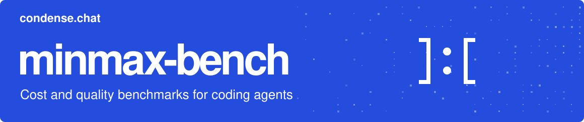
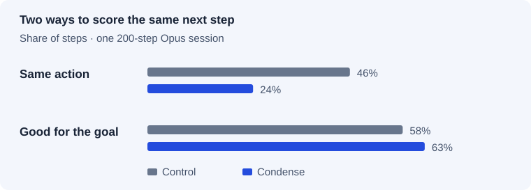
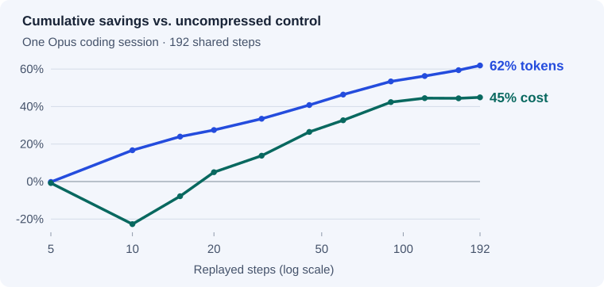
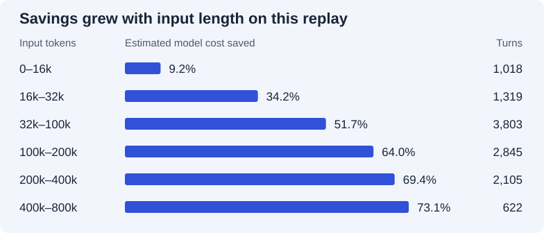

[condense.chat](https://condense.chat) · [condense.chat/docs](https://condense.chat/docs/) · [helm.condense.chat](https://helm.condense.chat)

**Does compressing an agent’s context make the task cheaper to finish?** Replay recorded sessions to price the same work, then let the agent run independently to see whether it still solves the task.

[Browse the benchmark site](https://condense-chat.github.io/dense/benchmarks/) · [Reproduce the Opus run](runs/run-5c61ab52-8eea-4fee-97a4-5c64ee5344af/README.md) · [Quality](#quality) · [Explore the datasets](data/README.md)

## Results by strategy

On six SWE-chat sessions capped at 190k input tokens, **Condense cut model cost by 28.0%**, Headroom cache mode by **13.8%**, and Kompress by **1.8%**. All three used Claude Haiku 4.5.

| Strategy | Matched turns | Baseline | After | Input tokens saved | Cost saved |
| --- | --- | --- | --- | --- | --- |
| Condense | 1,600 | $18.17 | $13.08 | 50.7% | 28.0% |
| Headroom · cache mode | 1,573 | $17.66 | $15.22 | 15.2% | 13.8% |
| Headroom · Kompress | 1,571 | $17.63 | $17.31 | 11.8% | 1.8% |

Kompress cut input tokens by 11.8%, but earlier edits to the prompt meant paying for fresh cache writes. Each row compares the strategy with its own matched baseline. [Inspect the Haiku run](runs/run-202f98bd-a2f1-4390-8307-658b451b7727/README.md).

## Quality

### Does the agent still finish the task?

A cost replay holds the conversation fixed. To test quality, let the agent choose its next step or run the entire task against its verifier.

### What the next-step scores measure

At each step of a recorded Opus coding session, the benchmark gives the agent the history so far and asks what it would do next. **Action agreement** counts how often it picks the same action as the recording. **Goal quality** counts how often a judge rates the proposed action as useful for the task. Two different tool calls can both move the work forward.



Even the uncompressed control reproduced the original action only **46%** of the time. Its **58%** goal score also fell below the study’s calibration target. The five-point difference on this one session therefore leaves the quality comparison uncertain. Condense also re-read previously retrieved information **17 times**, compared with **14** for control. [See the scoring rubric and replay](docs/quality.md#what-the-next-step-scores-measure).

### What the task verifier found

In a separate Opus 4.8 experiment, Claude Code worked through 14 long Terminal-Bench tasks. Each trial started from the task prompt and ended with an automated check of the final state.

| Agent | Successful trials | Solve rate | Reported 95% interval |
| --- | --- | --- | --- |
| Vanilla Claude Code | 23 / 34 | 68% | 51–81% |
| Condense | 11 / 14 | 79% | 52–92% |
| Headroom | 10 / 14 | 71% | 45–88% |

The trial counts differ, and the intervals overlap widely. This run leaves the ordering of the three strategies unresolved. [Published trial results](https://condense.chat/blog/evaluating-agent-quality/).

### What an independent trial costs

A second full-task comparison covered 56 Condense trials and 70 vanilla trials. Condense cost **27.9% more per trial** when the agent could choose its own path. The solve-rate difference was **−1.4 percentage points**, with a reported interval from −17 to +14. [Compare cost, turns and solve rate](docs/quality.md#read-a-full-task-result).

## How soon does compression pay off?



The first ten steps cost **$1.30 with Condense vs. $1.06 with control**. The gap closed around step 20. Across the 192 steps both arms completed, cost went from **$33.61 to $18.53**, with the same average round-trip time of **20.7 seconds**. [See the published experiment](https://condense.chat/blog/evaluating-agent-quality/).

## How much does input length matter?

Across **64 sessions and 11,712 turns**, the Opus 4.8 rewrite replay priced the original requests at **$861.28** and the Condense requests at **$312.20**, a **63.8%** reduction. The estimate simulates cache usage and excludes optimizer fees. [Inspect the Opus run](runs/run-5c61ab52-8eea-4fee-97a4-5c64ee5344af/README.md).



## Try it without a model key

Install [uv](https://docs.astral.sh/uv/), then run the commands below. The first setup downloads dependencies. After that, reporting on the saved measurements works offline.


```sh
git clone https://github.com/condense-chat/minmax-bench.git
cd minmax-bench
uv sync
uv run minmax-bench report 5c61ab52-8eea-4fee-97a4-5c64ee5344af
```


## Explore the reference runs

| Run | Matched turns for Condense | Model cost before → after | Cost saved |
| --- | --- | --- | --- |
| [Opus 4.8 · rewrite](runs/run-5c61ab52-8eea-4fee-97a4-5c64ee5344af/README.md) | 11,712 | $861.28 → $312.20 | 63.8% |
| [Haiku 4.5 · 190k cap](runs/run-202f98bd-a2f1-4390-8307-658b451b7727/README.md) | 1,600 | $18.17 → $13.08 | 28.0% |
| [Haiku 4.5 · uncapped](runs/run-cba32b86-99ba-4ed7-bf7c-e385edf2ec99/README.md) | 2,909 | $56.69 → $35.52 | 37.3% |

The two Haiku runs use the same six recorded sessions. Each run page includes every measured strategy, its matched turns, and its own baseline.

## First Run

minmax-bench checks whether a cost optimizer (like condense) saves money without making
the agent worse. A quality run has Claude Code solve real Terminal-Bench tasks in Docker,
once with the optimizer and once without it ("vanilla"). It then compares cost and solve
rate.

Setup, once (needs [uv](https://docs.astral.sh/uv/) and Docker running):

```bash
git clone git@github.com:condense-chat/minmax-bench.git && cd minmax-bench
uv sync && uv tool install harbor
uv run minmax-bench setup   # guided: your Claude login (or an API key), plus `dense login` for condense
```

Run one short task on Opus 5.5 with your Claude subscription. This does 2 condense runs
and 3 vanilla runs, each capped at $5:

```bash
uv run minmax-bench quality run --auth subscription -m claude-opus-5-5 \
  --arms condense --tasks path-tracing --k 2
```

It checks your credentials before it spends anything. `uv run minmax-bench quality runs`
lists your runs and shows how to open each report. Run `quality run` with no flags to get
a step-by-step wizard instead.

### Why one run proves nothing

Every run takes its own path. Even two vanilla runs differ in turns, cost and whether they
solve the task. So vanilla runs one extra time to measure how much it varies by itself
(the noise floor). The optimizer passes if it stays within the vanilla-vs-vanilla spread.
It doesn't have to match vanilla exactly.

A verdict needs at least 2 finished runs per arm. `--k 2` is a first look; use the
default `--k 4` for a verdict.

More: [docs/explainer.md](docs/explainer.md) explains why each kind of evaluation exists
and covers the cheaper incremental mode. [docs/quality.md](docs/quality.md) lists every
flag.

## Run a new experiment

| Question | Where to start |
| --- | --- |
| How much would the same recorded work cost? | [Cost replay and cache pricing](docs/cost.md) |
| Would a shorter history change the next tool call? | [Incremental replay](docs/quality.md#replay-the-next-decision) |
| Does the agent finish the task at a lower cost? | [Full task runs](docs/quality.md#run-a-task-end-to-end) |
| How do I compare another strategy? | [Strategy matrix and executors](docs/architecture.md) |

Run `uv run minmax-bench setup` to configure access, then `uv run minmax-bench run` to choose an experiment. A fresh live run uses model quota. The [evaluation guide](docs/explainer.md) explains how to choose tasks and controls.

[MIT license](LICENSE) · [Report an issue](https://github.com/condense-chat/minmax-bench/issues)
